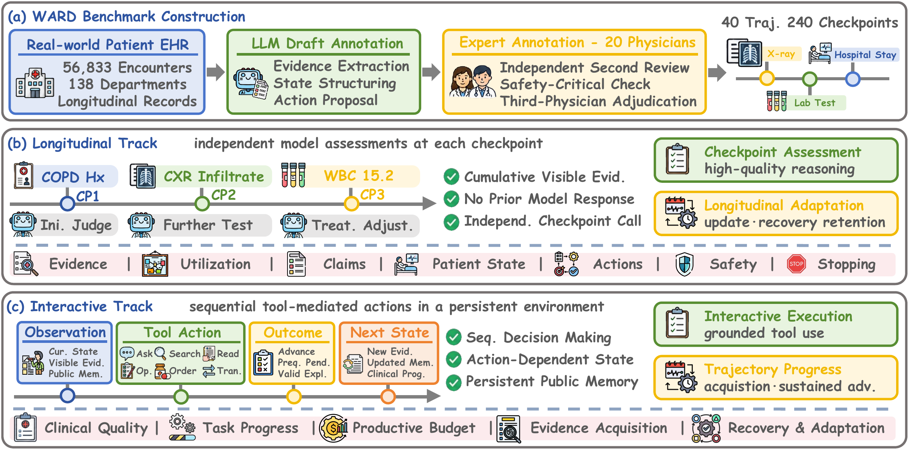

<h1 align="center">WARD</h1>

<p align="center"><strong>The patient record changed. Did the agent?</strong></p>

<p align="center"><em>Seeing Is Not Acting: WARD Diagnoses the Evidence-to-State-to-Action Gap in Longitudinal Clinical Agents</em></p>

<p align="center">
  <a href="#why-ward">Why WARD</a> ·
  <a href="#two-examples">Examples</a> ·
  <a href="#results-at-a-glance">Results</a> ·
  <a href="#quick-start">Quick start</a> ·
  <a href="longitudinal/README.md">Longitudinal</a> ·
  <a href="interactive/README.md">Interactive</a> ·
  <a href="data/README.md">Data</a>
</p>

WARD is for researchers and developers who build or evaluate clinical language-model agents. It tests whether an agent **uses new evidence, updates its assessment, and takes an appropriate next action** as a patient's record evolves.

| If you are… | Use WARD to… | Start here |
| :--- | :--- | :--- |
| A **clinical AI researcher** | Locate the step where a model's reasoning breaks across successive checkpoints. | [Longitudinal track](longitudinal/README.md) |
| An **agent developer** | Test tool use, prerequisites, recovery, and progress in a persistent clinical environment. | [Interactive track](interactive/README.md) |
| An **evaluation team** | Audit scoring, model-visible inputs, and data boundaries. | [Data guide](data/README.md) and [scoring guide](longitudinal/README.md#offline-evaluation) |

## Why WARD

A final answer can look plausible even when the agent ignored a new result, kept an outdated picture of the patient, or acted before a prerequisite was met. WARD measures that **evidence → state → action** chain directly.


*The paper's motivating example: new findings should change both the patient's assessed state and the next decision. The illustration explains the evaluation problem; it is not a reference answer for a released case.*

WARD covers **40 longitudinal trajectories**, **240 checkpoints**, and **4,560 clinical tasks** drawn from **95 hospitalizations**. The released interactive subset contains **10 cases**. The two tracks ask different questions:

| Track | Agent setting | What the evaluation reveals |
| :--- | :--- | :--- |
| **Longitudinal** | The model answers independently at each checkpoint using the cumulative record visible then. Earlier model answers are not passed forward. | Whether it identifies evidence, links that evidence to claims, updates patient state, chooses actions, respects safety constraints, and knows when to stop. |
| **Interactive** | The agent uses clinical tools over multiple turns in a persistent environment. | Whether it acquires evidence, satisfies prerequisites, advances the case, recovers from blocked actions, and uses its action budget productively. |

<details>
<summary>See the benchmark construction and both evaluation tracks</summary>



</details>

## Two examples

### 1. Seeing a result without changing the plan

The paper illustration follows a patient with dyspnea as more information becomes available. This is an **illustrative scenario**, not a scored answer for `ward_001`.

| Moment | Record available to the agent | Failure WARD can distinguish |
| :--- | :--- | :--- |
| Initial assessment | Dyspnea, COPD history, and low oxygen saturation. | An unsupported claim about the patient's state. |
| New evidence | Chest imaging shows a new infiltrate, the white-cell count is elevated, and oxygen need rises. | The agent mentions the findings but leaves its assessment unchanged. |
| Decision point | Hypoxia and its cause remain unresolved. | The agent recommends a premature transition instead of responding to the unresolved blocker. |

A model can therefore receive credit for **recognizing** evidence while still failing on **patient state** or **action**. The [checkpoint schema](longitudinal/src/ward_eval/schemas/checkpoint_submission.v1.schema.json) makes these outputs separately inspectable.

### 2. A blocked action, then recovery

The repository includes a **fully synthetic, non-official** interactive fixture. Its three scripted calls make a different failure visible:

| Turn | Tool call | Environment response |
| :--- | :--- | :--- |
| 1 | `care.transition` before gathering history | Prerequisite pending; the case does not advance. |
| 2 | `patient.ask` for the synthetic history | Evidence is released; one transition advances. |
| 3 | `care.transition` again | The remaining transition advances. |

The offline evaluator reports **2 of 2 milestones completed**, **2 productive actions within a budget of 4**, and **recovery from the pending prerequisite**. These are software-fixture results, not clinical performance or an official WARD score. You can reproduce this trace in [Quick start](#quick-start).

## Results at a glance


In the paper's reported medians, evidence recognition reaches **48.42%**, while patient-state and next-action scores are **17.72%** and **11.81%**. In the Interactive Track, **11.46%** of executed actions advance a reference transition. The pattern illustrates the gap between noticing a result and using it to guide care. These are paper results; the packaged data are a separately versioned, anonymized successor release.

## Quick start

Use Python 3.11 or newer from the repository root. Validate a released interactive case without an API call:

```bash
python3 -m pip install -r requirements.txt
python3 interactive/run.py --case ward_001 --dry-run
```

To see a complete action trace and evaluation **without credentials or patient-derived text**, run the synthetic fixture:

```bash
python3 interactive/tests/fixture.py /tmp/ward-demo
python3 interactive/run.py \
  --case ward_001 \
  --case-config /tmp/ward-demo/case.json \
  --scripted-actions /tmp/ward-demo/actions.json \
  --output /tmp/ward-demo-run
python3 interactive/eval.py \
  --run /tmp/ward-demo-run \
  --case-config /tmp/ward-demo/case.json \
  --output /tmp/ward-demo-scores.json
```

Inspect `/tmp/ward-demo-run/tool_trace.json` for each call and `/tmp/ward-demo-scores.json` for the metrics. The fixture reuses the `ward_001` identifier but contains artificial transitions; do not combine its score with released-case results.

### Run your model

Both tracks accept a compatible model endpoint. Keep credentials outside the repository:

```bash
export WARD_API_KEY="YOUR_API_KEY"
export WARD_BASE_URL="https://api.example.com"
export WARD_API_BASE_URL="https://api.example.com/v1"
```

`WARD_BASE_URL` is the provider origin for Longitudinal; `WARD_API_BASE_URL` ends in `/v1` for Interactive. Set your deployment's model ID and follow the track you want to evaluate:

- **Longitudinal:** configure the [example model roster](longitudinal/config/model_roster.example.json), then use the [prepare, execute, and scoring instructions](longitudinal/README.md).
- **Interactive:** run `python3 interactive/run.py --case ward_001 --model YOUR_MODEL_ID --output runs/YOUR_MODEL_ID/ward_001`, then follow the [evaluation instructions](interactive/README.md#evaluate-selected-runs).

Longitudinal scoring reports seven F1 dimensions and temporal diagnostics; semantic matches may require the configured judges. Interactive scoring reports trajectory progress and action efficiency. **Clinical quality is a separate human rating**, not inferred from environment progress. Neither track produces a single total score.

## Data and evaluation boundary

> **Keep evaluator-side references out of model inputs.** Reference answers, hidden prerequisites, and unreleased evidence are used for evaluation. The runners build the model-visible requests and observations.

The [data guide](data/README.md) explains the released files, visibility rules, anonymized successor version, and verification commands. It also distinguishes the interactive reference graph from the longitudinal checkpoint references.

| Path | Contents |
| :--- | :--- |
| [`data/`](data/README.md) | Cases, references, manifests, and data verification. |
| [`longitudinal/`](longitudinal/README.md) | Independent checkpoint inference, schemas, and scoring. |
| [`interactive/`](interactive/README.md) | Clinical tools, persistent environment, runner, and metrics. |
| [`figs/`](figs/) | Paper illustrations and the results chart. |
