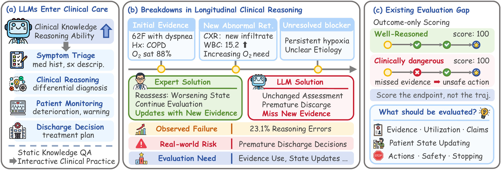
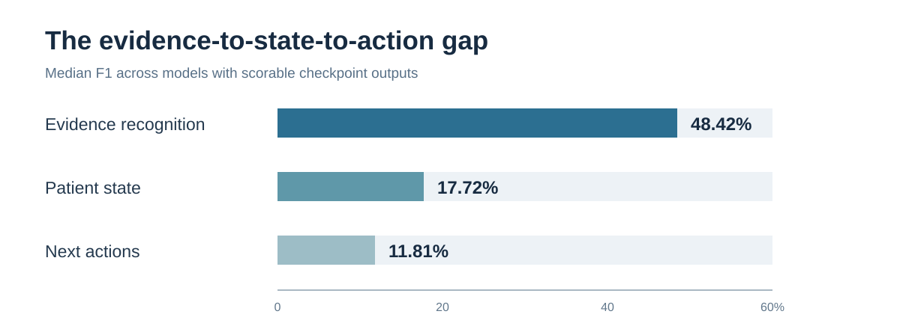

<h1 align="center">WARD</h1>

<p align="center"><strong>Seeing Is Not Acting: WARD Diagnoses the Evidence-to-State-to-Action Gap in Longitudinal Clinical Agents</strong></p>

<p align="center">A process-level benchmark for clinical agents working with evolving patient records.</p>

<p align="center">
  <a href="#overview">Overview</a> ·
  <a href="#results-at-a-glance">Results</a> ·
  <a href="#quick-start">Quick start</a> ·
  <a href="longitudinal/README.md">Longitudinal track</a> ·
  <a href="interactive/README.md">Interactive track</a> ·
  <a href="data/README.md">Data guide</a>
</p>

## Overview

Clinical agents must do more than notice a new test result. They need to revise their understanding of the patient and choose the next action as the record evolves. WARD evaluates this **evidence → state → action** chain instead of judging only the final answer.



*A patient record changes over time. The same final outcome can hide a missed result, an outdated assessment, or an unsafe action.*

WARD contains **40 longitudinal trajectories**, **240 checkpoints**, and **4,560 clinical tasks** drawn from **95 hospitalizations**. It evaluates two complementary settings:

| Track | What the agent does | What WARD measures |
| :--- | :--- | :--- |
| **Longitudinal** | Responds independently at each checkpoint, using only the cumulative record visible at that time. | Evidence use, claims, patient state, actions, safety, stopping, and change over time. |
| **Interactive** | Acquires evidence and acts through clinical tools in a persistent environment. | Prerequisite resolution, clinical progress, efficiency, recovery, and action safety. |

<details>
<summary>See the benchmark construction and both evaluation tracks</summary>


</details>

## Results at a glance



In the paper's reported medians, performance falls from **48.42%** on evidence recognition to **17.72%** on patient state and **11.81%** on next actions. In the Interactive Track, **11.46%** of executed actions advance a reference transition. These measures show where recognition fails to become an updated assessment or useful action.

## Quick start

Use Python 3.11 or newer. Run these commands from the repository root.

```bash
python -m pip install -r requirements.txt
python interactive/run.py --case ward_001 --dry-run
```

The dry run validates a case and its assets without making model API calls. For a model run, configure an OpenAI-compatible endpoint and keep credentials outside the repository:

```bash
export WARD_API_KEY="YOUR_API_KEY"
export WARD_BASE_URL="https://api.example.com"
export WARD_API_BASE_URL="https://api.example.com/v1"
```

The Longitudinal runner takes the provider origin (`WARD_BASE_URL`) and appends `/v1/chat/completions`. The Interactive runner takes the API base ending in `/v1` (`WARD_API_BASE_URL`). Replace the example endpoint and model ID with your deployment.

## Longitudinal track

Each checkpoint produces a structured JSON response covering evidence, evidence-utilization links, claims, patient state, actions, safety constraints, and stopping decisions. The [submission schema](longitudinal/src/ward_eval/schemas/checkpoint_submission.v1.schema.json) defines the executable format.

Copy [the example model roster](longitudinal/config/model_roster.example.json) to `models.local.json`, then set `models[0].model_id` and the inference parameters. Use one model per job.

```bash
python longitudinal/run.py prepare \
  --gold data/longitudinal \
  --roster models.local.json \
  --output output/checkpoint-job

python longitudinal/run.py execute \
  --job output/checkpoint-job \
  --roster models.local.json \
  --output output/checkpoint-run
```

The model receives each checkpoint independently; earlier model predictions are not passed forward. The runner writes `raw_model_submissions.jsonl`, request and attempt records, and a run manifest.

### Score checkpoint responses

Use **DeepSeek-V4-Pro (Judge-B)** as the primary semantic evaluator and **Qwen3.7-Max (Judge-A)** for sensitivity analysis, as in the paper. Configure their deployment IDs and endpoints in the [judge examples](longitudinal/config/). The [Longitudinal instructions](longitudinal/README.md#semantic-judging) include cache-generation commands.

```bash
python longitudinal/eval.py \
  --gold data/longitudinal \
  --submissions output/checkpoint-run/raw_model_submissions.jsonl \
  --judge-cache output/judge-finalization/private/judge_cache.v1.json \
  --prompt-manifests output/checkpoint-job/prompt_request_manifests.jsonl \
  --model-id your-model-id \
  --output output/checkpoint-scores
```

Scores cover seven clinical output domains, stopping-decision accuracy, critical-action recall, and temporal diagnostics such as linked-evidence nonresponse and evidence regression. Checkpoint counts are pooled within each case before computing F1, then averaged across cases. See the [Longitudinal instructions](longitudinal/README.md) for scoring details and output files.

## Interactive track

The environment exposes seven tools: `patient.ask`, `ehr.search`, `ehr.read`, `ehr.order`, `procedure.perform`, `treatment.start`, and `care.transition`. It checks prerequisites, releases evidence, and advances the recorded clinical state.

```bash
python interactive/run.py --case ward_001 --dry-run

python interactive/run.py \
  --case ward_001 \
  --model your-model-id \
  --output output/interactive/your-model-id/ward_001

python interactive/eval.py \
  --run output/interactive/your-model-id/ward_001 \
  --output output/interactive/scores.json
```

For providers requiring a single dispatcher, add `--protocol dispatcher`. An interrupted API run can continue with `--resume-from PATH`; select the final continuation rather than counting its prefix as a separate case. In the supplied 10-case subset, `ward_007` has a 20-action budget and the other nine cases have 40.

The evaluator reports milestone coverage, productive budget yield, reference-evidence recall, repeated actions without new evidence, recovery, and termination status. **Clinical quality is a separate 1–7 human rating**; pass independently collected ratings with `--clinical-ratings`. Missing ratings remain missing and are not inferred from environment progress. See the [Interactive instructions](interactive/README.md) for transport, continuation, validation, and rating formats.

## Data boundary

> **Keep evaluator-side references out of model inputs.** Reference answers, unreleased evidence, and hidden transition conditions are stored for evaluation. The runners construct the model-visible requests and observations. Do not send complete reference files to a target model.

The [data guide](data/README.md) describes the stored files, schemas, preparation, and verification steps. It also explains which evidence is available at each checkpoint and how interactive cases expose records through tools.

<details>
<summary>View a synthetic model-visible checkpoint example</summary>

```json
{
  "case_id": "ward_001",
  "checkpoint_id": "ward_001_cp_002",
  "public_time": "2125-01-02T09:00:00",
  "public_context": {
    "age_years": 62,
    "sex": "female",
    "setting": "inpatient",
    "initial_time": "2125-01-01T08:00:00",
    "admission_diagnosis": "Dyspnea under investigation"
  },
  "visible_evidence": [
    {
      "evidence_id": "doc:001",
      "record_kind": "document",
      "title": "Chest imaging report",
      "clinical_time": "2125-01-02T08:00:00",
      "available_time": "2125-01-02T08:30:00",
      "content": "A new pulmonary infiltrate is present."
    }
  ]
}
```

The clinical text is illustrative. The runner includes only evidence available at `public_time`.

</details>

## Repository guide

| Path | Contents |
| :--- | :--- |
| [`data/`](data/README.md) | Checkpoint references, interactive cases, preparation, and verification. |
| [`longitudinal/`](longitudinal/README.md) | Checkpoint runner, semantic judging, schemas, and scoring. |
| [`interactive/`](interactive/README.md) | Clinical tools, dispatcher, interrupted-run continuation, and metrics. |
| [`figs/`](figs/) | Paper diagrams and results illustration. |

For the paper's clinical and methodological context, start with the [benchmark overview](#overview). For runnable contracts and flags, use the track-specific guides linked above.
